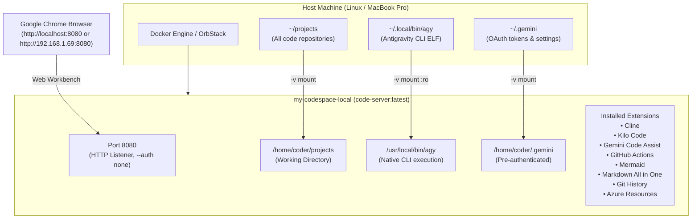

# Architectural Rationale & Design Decisions

This document details the engineering thought process, technical rationale, and trade-off analysis behind the architecture and configurations implemented in `my-codespace`.

---

## 🎯 1. Architectural Goals & Constraints

1. **Zero-Latency Portability:** Provide a complete Visual Studio Code Web experience accessible from any browser (such as Chrome on MacBook Pro or Chromebook) with identical behavior locally and in GitHub Codespaces.
2. **Unified Workspace Hierarchy:** Allow developers to work across all project repositories located in `~/projects` simultaneously, rather than being confined to an isolated single repo sandbox.
3. **AI-First Tooling Integration:** Embed Google Antigravity (`agy`), autonomous agents (Cline, Kilo Code), and LLM assistants (Gemini Code Assist) directly inside the development container.
4. **Zero-Friction Authentication:** Eliminate repetitive password lookups on local environments while maintaining secure credential passthrough for Git, Azure, and Google AI services.
5. **Continuous Verification:** Provide automated tests to validate container states, mounts, extensions, and network endpoints.

---

## 🧠 2. Core Decisions & Thought Rationale

### Decision 1: Full `~/projects` Directory Mounting
- **Problem:** Mounting only `$(pwd):/home/coder/project` limited the container's scope to `my-codespace`. Developers could not edit or run commands across sister repositories (`bots`, `chromeTerminal`, `delivery-pilot-web`, `ContractorExpenses`, etc.).
- **Thought Process:**
  - In a local workstation environment, developers frequently work across microservices, shared libraries, and configuration repositories.
  - Mapping the entire `$HOME/projects` to `/home/coder/projects` and setting the working directory `-w /home/coder/projects` directly opens the parent tree in the VS Code explorer sidebar.
  - Preserving the host UID/GID (`-u $(id -u):$(id -g)`) guarantees file creations or edits within the container maintain correct host filesystem ownership without permissions drift.

### Decision 2: Antigravity CLI (`agy`) Passthrough Strategy
- **Problem:** Antigravity CLI (`agy`) requires glibc dependencies, local OAuth credentials (`~/.gemini/antigravity-cli`), and active session tokens. Re-installing or re-authenticating inside an ephemeral container adds friction and token fragmentation.
- **Thought Process:**
  - Evaluated three approaches:
    1. *Full containerized re-install:* Would require web browser OAuth login dance on every fresh container instantiation.
    2. *Headless API key injection:* Bypasses user profile and does not persist conversation histories or customized skills.
    3. *Host Binary & Token Passthrough:* Mount `$HOME/.local/bin/agy` read-only to `/usr/local/bin/agy:ro` and `$HOME/.gemini` to `/home/coder/.gemini`.
  - **Selected Approach:** Option 3. Because `code-server` runs on a Debian/Ubuntu base matching the host architecture (x86_64 glibc), the ELF binary executes natively. Mounting `~/.gemini` seamlessly preserves active tokens, skills, rules, and conversation memory.

### Decision 3: Authentication & Host Routing Resolution
- **Problem:** When navigating to `http://localhost:8080/`, `code-server` defaulted to password authentication, generating an ephemeral password in an internal YAML file. Furthermore, accessing from a secondary machine (e.g. MacBook Pro connecting to a Linux VM/container host at `192.168.1.69`) routed `localhost` to the laptop loopback.
- **Thought Process:**
  - For personal local development behind an internal LAN/firewall, a secondary password prompt in code-server introduces unnecessary latency without providing tangible network security beyond what host-level isolation already offers.
  - Passing `--auth none` immediately redirects the browser to `./?folder=~/projects`.
  - Clearly documenting host IP routing (`http://192.168.1.69:8080`) alongside SSH port-forwarding options (`ssh -N -L 8080:localhost:8080 user@host`) gives developers choice between direct LAN access and secure tunneling.

### Decision 4: Extension Selection & Open VSX Marketplace Resolution
- **Problem:** Different developer tools need to coexist inside the web editor across AI coding, cloud development, version control, and documentation.
- **Selected Extensions & Rationale:**
  1. **Cline (`saoudrizwan.claude-dev`):** Autonomous AI agent for executing complex multi-file coding workflows and terminal commands.
  2. **Kilo Code (`kilocode.kilo-code`):** Context-aware AI coding copilot and inline autocomplete.
  3. **Gemini Code Assist (`Google.geminicodeassist`):** Google's deep AI coding integration with multi-turn chat and repository awareness.
  4. **GitHub Actions (`GitHub.vscode-github-actions`):** Local authoring, linting, and workflow inspection for CI/CD pipelines.
  5. **Mermaid Preview (`bierner.markdown-mermaid`):** Diagram-as-code rendering for software architecture documentation.
  6. **Markdown All in One (`yzhang.markdown-all-in-one`):** Comprehensive Markdown editing, table formatting, and live preview.
  7. **Git History (`donjayamanne.githistory`):** Visual git log, branch comparison, and commit file diffs directly inside the Web UI.
  8. **Azure Resource Groups (`ms-azuretools.vscode-azureresourcegroups`):** Management and deployment interface for Azure cloud resources.

### Decision 5: Automated Verification & Regression Prevention
- **Problem:** Manual browser testing is error-prone and doesn't protect against regressions when updating container arguments or image versions.
- **Thought Process:**
  - Created two complementary testing layers:
    1. **Shell Health Runner (`tests/run_tests.sh`):** Rapid pass/fail feedback for terminal scripts and CI pipelines. Specifically designed to handle bash `set -euo pipefail` without false positives from `SIGPIPE`.
    2. **Python Unit Suite (`tests/test_codespace.py`):** Structured assertions against JSON syntax, Docker daemon socket, container inspection, volume mount file presence, HTTP 302 redirects, and HTML workbench 200 responses.
  - Added verification that all 8 installed extensions are confirmed present in `code-server --list-extensions`.

---

## 📊 Summary of Implemented Architecture

