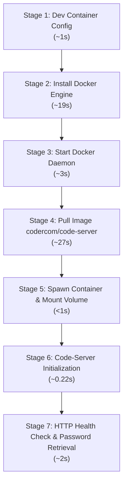

# Pipeline Stages and Execution Benchmarks

This document tracks all the setup and execution stages for running the local and cloud codespace environment, including the observed runtimes and resource profiles.

---

## ⏱️ Execution Stages Summary

| Stage # | Stage Name | Description | Observed Duration | Status |
|:-------:|:-----------|:------------|:-----------------:|:------:|
| **1** | **Repository & Dev Container Setup** | Created `.devcontainer/devcontainer.json` specifying base image, port forward, and VS Code extensions. | **~1 sec** | ✅ Completed |
| **2** | **Docker Engine Installation** | Installed Debian `docker.io` package and associated dependencies via `apt-get`. | **~19 sec** | ✅ Completed |
| **3** | **Docker Daemon Activation** | Configured group permissions (`usermod -aG docker`) and started `docker.service`. | **~3 sec** | ✅ Completed |
| **4** | **Image Pull (`code-server`)** | Downloaded layers and extracted `codercom/code-server:latest` (~245 MB compressed). | **~27 sec** | ✅ Completed |
| **5** | **Container Instantiation** | Spawned daemonized container `my-codespace-local` with port mapping (`8080:8080`) and volume bind mount. | **< 1 sec** | ✅ Completed |
| **6** | **Service Readiness & Auth Setup** | `code-server` started HTTP listener on `0.0.0.0:8080` and generated session auth config. | **~0.22 sec** | ✅ Completed |
| **7** | **Health Check & Verification** | Verified HTTP `302 Found` redirect to `./login` and extracted session password. | **~2 sec** | ✅ Completed |
| **Total** | **End-to-End Cold Start** | From bare OS environment to fully operational Web IDE. | **~52 sec** | ✅ Operational |

---

## 🔍 Detailed Breakdown by Stage



### Stage 1: Repository & Dev Container Setup
- **Action:** Created [`.devcontainer/devcontainer.json`](.devcontainer/devcontainer.json) configuring base Ubuntu image, port `8080`, and VS Code extensions (`dbaeumer.vscode-eslint`, `esbenp.prettier-vscode`).
- **Duration:** ~1 second.

### Stage 2: Docker Engine Installation
- **Action:** Updated apt package lists and installed `docker.io` (Debian 12 Bookworm).
- **Duration:** 19 seconds (`19:01:59Z` – `19:02:18Z`).
- **Dependencies installed:** `containerd`, `runc`, `iptables`, `apparmor`.

### Stage 3: Docker Daemon Activation
- **Action:** Enabled and started `docker.service` under systemd.
- **Duration:** 3 seconds (`19:02:23Z` – `19:02:26Z`).
- **Status:** Active (running), Main PID `70699`.

### Stage 4: Image Pull (`codercom/code-server:latest`)
- **Action:** Pulled container image layers from Docker Hub.
- **Size:** ~245 MB compressed / ~1 GB uncompressed.
- **Duration:** 27 seconds (`19:02:30Z` – `19:02:57Z`).

### Stage 5: Container Instantiation
- **Action:** Executed container run with volume mount and port binding:
  ```bash
  docker run -d \
    --name my-codespace-local \
    -p 8080:8080 \
    -v "$(pwd):/home/coder/project" \
    -u "$(id -u):$(id -g)" \
    codercom/code-server:latest
  ```
- **Duration:** < 1 second.
- **Container ID:** `747ac4f31f5ffd248b968a5c20d964c2272933d65bd958b092fcafb37a125674`.

### Stage 6: Code-Server Initialization
- **Action:** `code-server 4.141.0` generated default configuration `/home/coder/.config/code-server/config.yaml` and opened listener on `http://0.0.0.0:8080/`.
- **Duration:** ~222 ms (`19:02:57.455Z` – `19:02:57.677Z`).

### Stage 7: Health Check & Password Retrieval
- **Action:** Checked HTTP response header via `curl -sI http://localhost:8080` (returned HTTP `302 Found` redirecting to `./login`) and retrieved auth token.
- **Duration:** ~2 seconds.

---

## ⚡ Warm Start Performance (Subsequent Runs)

Once Docker is installed and the image is cached, subsequent launches take:
- **`docker start my-codespace-local`:** **~1.5 seconds** total.
